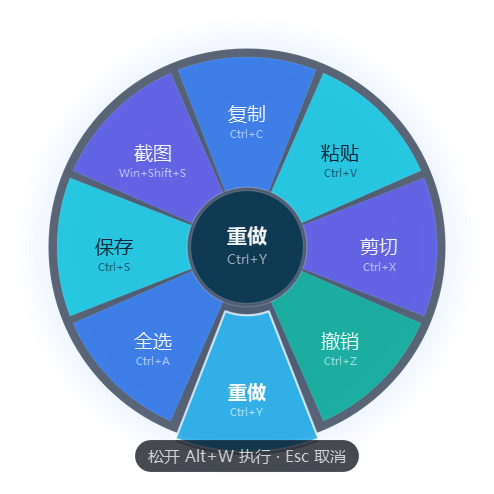
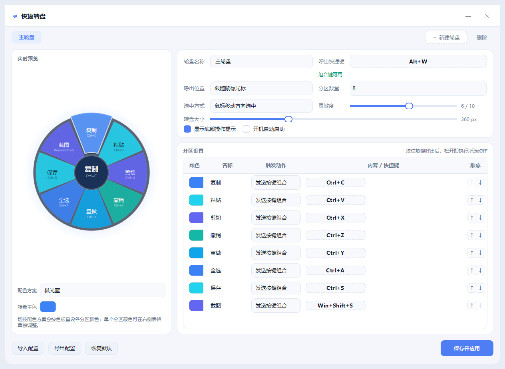

# 快捷转盘 QuickDial

一个用全局快捷键呼出的圆形径向菜单（Radial Menu）工具，Windows 10 / 11 适用。

按住热键 → 转盘在光标处弹出 → 移动鼠标或滚动滚轮选块 → 松开热键即执行。全程不用点鼠标，光标也不会跳动。

> A radial menu launcher for Windows that appears at your cursor on a global hotkey. Hold the hotkey, aim with the mouse (or scroll), release to run — no clicking, no cursor jump.





## 特性

- **全局快捷键呼出**：任意组合键（Ctrl/Alt/Shift/Win + 字母/数字/F1–F24/符号/小键盘），低层键盘钩子实现，不需要窗口焦点
- **跟随光标或屏幕居中**：每个轮盘独立设置；跟随模式下圆心精确落在呼出瞬间的光标位置
- **2–12 个分区**，180–760 px 可调大小，增删分区保留已有内容
- **分区顺序自由调整**：设置页每行 `↑` `↓` 一键换位，顺序即转盘上顺时针的排列
- **鼠标点击直发**：用鼠标点某个分区立即执行，转盘转为悬停状态不消失，可连续点按多个分区；点中心圆或转盘外即关闭
- **鼠标方向选中 / 滚轮切换**：鼠标模式带死区与角度滞后，边界不抖动；灵敏度 1–10 可调
- **选中项轻微浮出**：外扩 + 沿半径外移 + 提亮 + 投影，60 fps 缓动
- **松开热键执行**：松开热键的任意一键（主键或修饰键）即结束；发送动作前会等修饰键真正释放，避免 `Ctrl+C` 变成 `Ctrl+Alt+C`
- **四类动作**：发送按键组合（点击录制，支持单键）、打开程序/文件（可带参数）、打开网页、系统媒体键
- **多轮盘标签页**：每个轮盘独立热键、配色与分区
- **热键冲突检测**：本程序轮盘互查 → Windows 保留组合表 → `RegisterHotKey` 实测占用
- **8 套配色方案** + 转盘主色自定义 + 每个分区单独取色
- **配置导入导出**（JSON），支持开机自启

## 快速开始

### 方式一：下载 EXE（推荐）

到 [Releases](../../releases) 下载 `快捷转盘.exe`，双击即可，免安装。

首次启动会弹出设置窗口，关闭后程序常驻系统托盘。

### 方式二：从源码运行

```bash
git clone https://github.com/<your-name>/quickdial.git
cd quickdial
python -m venv .venv
.venv\Scripts\python.exe -m pip install PySide6-Essentials pyinstaller
.venv\Scripts\python.exe main.py
```

### 打包成单文件 EXE

```bash
.venv\Scripts\python.exe build.py
# 产物：dist\快捷转盘.exe
```

## 怎么用

按住 **Alt + W**（默认热键），转盘在光标处出现。之后有两种操作方式：

**方式一：悬停选择（不点鼠标）**

1. 移动鼠标指向某一分区（或用滚轮切换），选中的分区会轻微浮出
2. **松开热键** → 执行该分区的动作
3. 中途放弃：按 **Esc**，不会执行任何动作

**方式二：点击直发（可连击）**

1. 呼出后**直接点某个分区** → 立即执行该动作
2. 转盘**不会消失**，进入悬停状态，可以接着点其它分区，一个个执行
3. 关闭方式：**点转盘中心圆**（或转盘外的空白处），或按 **Esc**

> 悬停状态下的关闭入口只有「点中心」和「Esc」两种，其它操作都不会关掉转盘。

托盘图标：左键单击 = 打开设置，右键 = 设置 / 暂停热键 / 退出。

### 动作类型

| 类型 | 怎么设置 | 说明 |
|---|---|---|
| 发送按键组合 | 点击按钮后直接按下组合键 | 支持 `Ctrl+Shift+A` 这类组合，也支持 `F9` 这类单键；右键清除；录制时自动挂起全局热键 |
| 打开程序 / 文件 | 填写路径 | `notepad.exe`、`C:\Tools\app.exe --fast`、`D:\文档` 都行，路径不存在时会按「程序 + 参数」再试一次 |
| 打开网页 | 填写网址 | 缺少协议头会自动补 `https://` |
| 系统媒体键 | 下拉选择 | 音量 ±、静音、播放暂停、上一/下一曲、锁定屏幕 |

### 配置文件

- 位置：`%APPDATA%\QuickDial\config.json`
- 崩溃日志：`%APPDATA%\QuickDial\error.log`
- 写入使用「临时文件 + 原子替换」，断电不会写坏
- 设置页可导出/导入 JSON，方便备份或换机

## 项目结构

```
main.py              入口：单实例、托盘常驻、异常日志
build.py             一键打包（PyInstaller）
app/
  keys.py            按键映射：Qt 键码 ↔ Windows VK ↔ 可读标签，系统保留组合表
  native.py          Win32 层：低层键盘/鼠标钩子、SendInput、光标、热键探测
  config.py          配置模型：默认值、容错规范化、原子读写、导入导出
  theme.py           色板、颜色工具、界面样式表
  radial.py          转盘绘制（draw_wheel）与运行窗口（RadialWheel）
  settings_ui.py     设置窗口、快捷键录制控件、扇区块编辑器
  actions.py         动作执行：按键模拟、启动程序、打开网页、媒体键
  controller.py      控制器：钩子事件 → 转盘 → 动作，托盘与自启
tests/
  selftest.py        逻辑自测（按键映射 / 配置容错 / 角度选中 / 渲染 / 钩子）
  ui_test.py         设置界面逻辑（标签页 / 扇区 / 按键录制 / 配色 / 冲突检测）
tools/
  e2e_test.py        端到端：真实注入热键 → 呼出 → 选中 → 执行
  repro_stuck.py     按键状态回归：残留检测、修饰键污染检测
  click_test.py      鼠标点击交互：点分区执行并悬停、连点、点中心关闭
  render_preview.py  离屏渲染转盘预览图
  make_icon.py       生成多尺寸图标
```

## 测试

```bash
.venv\Scripts\python.exe tests\selftest.py     # 72 项逻辑自测
.venv\Scripts\python.exe tests\ui_test.py      # 29 项界面逻辑
.venv\Scripts\python.exe tools\e2e_test.py     # 21 项端到端（会短暂接管键盘）
.venv\Scripts\python.exe tools\repro_stuck.py  # 23 项按键状态回归
```

`e2e_test.py` / `repro_stuck.py` 会真实安装全局钩子并注入按键，运行期间几秒内接管键盘，结束自动卸载。

## 已知限制

1. **单文件 EXE 启动约 1–3 秒**：PyInstaller onefile 需先解压到临时目录，这是换取「单个 exe 可直接拷走」的代价。
2. **权限不对等时无法注入按键**：若目标程序以管理员身份运行，普通权限的转盘发不过去（Windows UIPI）。需要时以管理员身份运行本程序。
3. **未签名 EXE 可能触发 SmartScreen**，部分杀毒软件对 PyInstaller 打包的程序会误报。
4. **全屏独占程序**（部分游戏、反作弊环境）可能收不到模拟按键，属系统级限制。
5. **单键热键（不带修饰键）会拦截正常打字**，设置页会给出黄色提醒但不阻止，建议始终带修饰键。
6. **滚轮模式依赖真实滚轮事件**：触摸板双指滚动、触摸屏滑动通常不产生 `WM_MOUSEWHEEL`，此时请改用鼠标移动模式。
7. **Win 组合键（如 Win+Shift+S）由系统优先处理**，模拟发送多数场景有效，个别系统版本可能被截获。
8. **热键占用检测仅供参考**：探测用临时 `RegisterHotKey`，实际呼出用低层钩子（优先级更高），所以「提示被占用」时通常仍可用。
9. **靠近屏幕边缘呼出时转盘会等比缩小**（最低 55%），极贴边时部分分区会超出屏幕，把光标往屏幕内挪一点即可。
10. **未做代码签名、多语言、自动更新**。

## 技术说明

几个踩过的坑，供参考：

- **修饰键码有左右之分**：低层钩子上报的是 `0xA4`（LAlt），不是 `0x12`（VK_MENU）。判断修饰键时必须归一化，否则抬起事件会被当成普通键吞掉，系统就永远认为 Alt 按着。
- **不要依赖主线程状态做吞键判断**：钩子回调在独立线程，「转盘是否打开」必须在该线程同步维护，否则快速按压时松开事件会在窗口弹出前到达，转盘卡死。
- **执行动作前等修饰键释放**：`Alt+W` 呼出后立刻发 `Ctrl+C`，实际会变成 `Ctrl+Alt+C`，必须等修饰键真正抬起。
- **PySide6 的 Flag 枚举不能 `int()`**：`Qt.ControlModifier` 要取 `.value`，否则报 `TypeError`。
- **样式表会级联到子控件**：给容器设 `background: transparent` 会把子按钮背景也刷掉，需要写成 `#ObjName { ... }` 限定作用域。

## License

[MIT](LICENSE)
